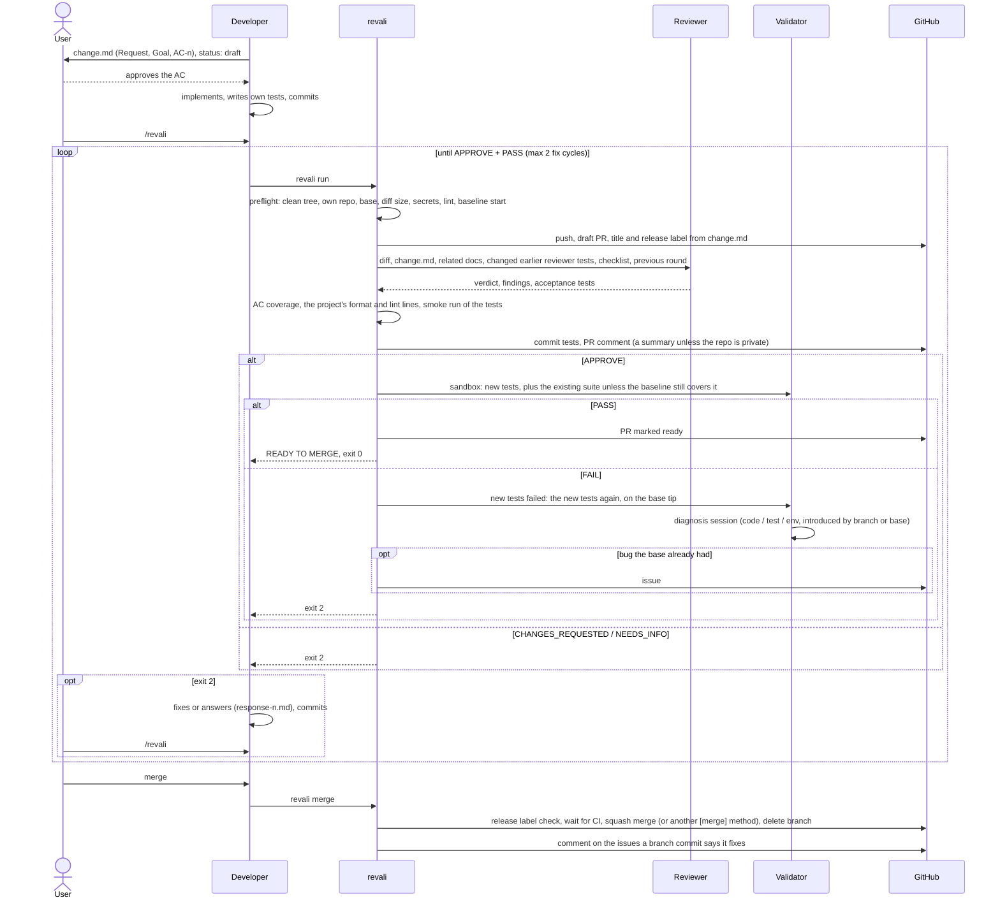

# revali

Review, validate, merge: a headless pipeline for feature branches on your own
GitHub repositories. An independent AI session reviews the branch against its
acceptance criteria and writes the acceptance tests, a sandbox runs them with
the existing suite, and the merge waits for the result. Three roles take part.

- **Developer**: the authoring session (Claude Code, or you). Writes the
  acceptance criteria before the code, gets them approved, implements, and
  types `/revali`.
- **Reviewer**: an independent headless session revali spawns. Reviews the
  diff against the acceptance criteria and writes the acceptance tests. It
  does not run them.
- **Validator**: a sandbox run of the existing suite plus the Reviewer's
  tests. When the Reviewer's tests fail, they run again on the base tip
  (`[validate] rerun_on_base`), and on any failure a diagnosis session reads the output and says whether the code, the
  test, or the environment is at fault, and whether the branch or the base
  introduced it; a bug the base already had gets a GitHub issue.

**What it does.**

| Capability | Described in |
|---|---|
| Acceptance criteria before the code: change.md's `AC-n` lines are approved first, and preflight refuses a draft | [docs/workflow.md](docs/workflow.md#workflow-1) |
| Checks before anything is pushed: a clean tree, your own repository, an up-to-date base, the diff size, secrets, the project's lint line | [docs/workflow.md](docs/workflow.md#running) |
| An independent review of the diff, the documents related to it and the earlier reviewer tests it changes, with acceptance tests written from the criteria | [docs/workflow.md](docs/workflow.md#why-separate-sessions) |
| Sandbox validation of the new tests and the existing suite through WSL, ssh or a local worktree, on each listed platform (`linux`, `windows`) | [docs/sandbox.md](docs/sandbox.md) |
| A diagnosis of each failure (code, test or environment, from the branch or the base) and a GitHub issue for a bug the base already had | [docs/configuration.md](docs/configuration.md) |
| A draft PR whose title and release label follow change.md, with each round's review as a comment (a summary when the repository is not private) | [docs/side-effects.md](docs/side-effects.md) |
| A merge only after READY TO MERGE: it waits for CI, merges by `[merge] method`, comments on the issues the branch fixes and archives the review files | [docs/side-effects.md](docs/side-effects.md) |
| Release notes grouped by the PRs' release labels | [docs/releasing.md](docs/releasing.md#release-notes-for-a-project-that-uses-revali) |
| Several agent sessions on one repository, one worktree each | [docs/workflow.md](docs/workflow.md#several-agents-on-one-repository) |
| Every round, validation and cost on record: `review-<n>.md`, `tests.md`, logs, a history row, `revali stats` | [docs/files.md](docs/files.md) |
| Configuration in three layers: revali's defaults, your user file, the project's `revali.toml` | [docs/configuration.md](docs/configuration.md) |
| A benchmark of how often the reviewer finds known bugs, replaying archived rounds | [bench/README.md](bench/README.md) |
| An audit of every document against the code before a release | [docs/releasing.md](docs/releasing.md#the-documentation-audit) |

**Why separate sessions.** Each role runs in its own session with its own
inputs, so nobody grades their own work: the Reviewer gets the acceptance
criteria, the diff and the documents the diff concerns, not the Developer's reasoning, the Validator is a
test run, not an opinion, and the diagnosis session gets change.md, tests.md, the
Reviewer's test files, the failing step's output, the base rerun and the other platforms'
outcomes, with read-only
access to the repository, but neither the Developer's nor the Reviewer's reasoning. The models can differ by tier (`auto` puts the Reviewer one tier
above the Developer) and, at the engine seam, by vendor
(only `claude` exists today). Fresh context removes the author's bias toward
its own change, not the blind spots the models share, which is why
`revali stats` tracks the first-try pass rate. The full argument is in
[docs/workflow.md](docs/workflow.md).



The preflight baseline (the existing suite in the sandbox) runs on every `revali run`
until the first review round is recorded, and not for `kind: docs`. A sandbox `setup` or
`build` failure is exit 1 (environment), not a FAIL verdict.

| Role | Started by | Reads | Writes | Model |
|---|---|---|---|---|
| Developer | the user | the request, the repo | `change.md`, code, its own tests | whatever the user's session runs; recorded as `author_model` |
| Reviewer | revali, on `/revali` | diff, `change.md`, the documents related to the diff, the earlier reviewer tests the change modifies, three-layer checklist, the previous round and `response-n.md` | tests in `test_dir` (formatted by the project's `format` line, committed once they pass the project's `lint` line and a smoke run; with `[review] tests = "archive"` kept under `.revali/<branch>/tests/` instead and never committed), and its answer, which revali turns into `review-n.md`, `tests.md`, and a PR comment (a summary when the repository is not private); does not run the tests | `auto`: one tier above the Developer |
| Validator | revali, after APPROVE | a sandbox clone of the branch; when the Reviewer's tests fail, one of the base tip with them copied in | logs; revali appends the result to `tests.md`; on FAIL only, the diagnosis session answers (with `introduced_by`: branch or base) and revali writes `diagnose-n.json` (`diagnose-n-<platform>.json` for each failing platform when several are listed), and opens a GitHub issue for a bug the base already had | the runner needs none; diagnosis `auto`: one tier below the Developer |

Three user actions (approve the AC, `/revali`, `revali merge`) are the gates;
everything between them is automatic. Exit codes: `0` done / ready to merge,
`1` pipeline error (not a verdict), `2` the Developer must act (fix, rebase,
answer a question), `3` a human must decide, `4` (`wait` only) still running.

Status: package version 0.4.0; [CHANGELOG.md](CHANGELOG.md) lists what each release
contains. Verified end to end on a private GitHub repository with real Reviewer sessions
and real WSL and ssh sandboxes ([docs/sandbox.md](docs/sandbox.md) has the record);
revali reviews its own changes on this public one.

## Requirements

- CI runs the suite on Linux, Windows and macOS hosts; no real review has run on macOS yet
- Python 3.11+ (stdlib only), git, GitHub CLI (`gh auth login` done)
- Claude Code CLI on PATH (`claude`), for the reviewer / diagnoser sessions
- A place to run the sandbox, one of three runners (`[validate.<platform>] runner`); a
  project validates on `linux`, `windows` or both (`[project] platforms`):

| Runner | Where the sandbox runs | Isolation | Platforms | Verified end to end |
|---|---|---|---|---|
| `runner = "wsl"` (default) | a clone inside a WSL distro (Ubuntu) on a Windows host | its own Linux system | `linux` | yes, 2026-08-30 and 2026-09-04 |
| `runner = "ssh"` | a clone on a machine reached by key-based ssh, with git, bash and coreutils installed (a Mac: Homebrew's coreutils, its `gnubin` on the PATH of the non-interactive ssh shell; not verified end to end) | another machine | `linux`; `windows` when bash is its ssh shell | `linux` yes, 2026-08-30; `windows` not yet |
| `runner = "local"` | a git worktree on the host itself: a host that is its own sandbox, or a first look before setting one up | no isolation | `linux`; `windows` on a Windows host | no record |

## Usage

```
python <revali dir>/revali.py init                     # once per project: write revali.toml, CONVENTIONS.md, CLAUDE.md, .github/release.yml that are missing
python <revali dir>/revali.py preflight [--base <b>]   # checks only (no lint, no baseline); fetches the base, commits and pushes nothing
python <revali dir>/revali.py run [--base <b>] [--reviewer-model <m>]   # detached (<m>: this run's reviewer); then:
python <revali dir>/revali.py wait --timeout 9m        # repeat until it returns other than 4; --branch <b> for another branch's run
python <revali dir>/revali.py merge                    # after READY TO MERGE (docs/files.md, stages); waits for CI
python <revali dir>/revali.py run --dry-run | --foreground   # what a run would do, sending nothing | run in this process
python <revali dir>/revali.py status [--branch <b>]    # stage, last message, rounds, fix cycles, cost, PR
python <revali dir>/revali.py stop                     # kill this working tree's run, or record a run that died as stopped
python <revali dir>/revali.py reset                    # drop the branch's state.json, keep its files
python <revali dir>/revali.py clean <branch>           # delete a branch's state directory
python <revali dir>/revali.py archive [--branch <b>]   # record a PR merged or closed without revali merge, archive its files
python <revali dir>/revali.py release <v> [--notes <line>] [--dry-run]   # on the pushed base tip with green CI: tag v<v>, push it, publish the GitHub Release
python <revali dir>/revali.py stats                    # the run history per repository: first-try pass rate, rounds, cost
python <revali dir>/revali.py version                  # the version; --version prints the same line
python <revali dir>/revali.py --verbose <command>      # echo every command revali runs to the terminal
```

What a run does, in order: preflight (ending with the existing suite in the sandbox
as a baseline, by default running on alongside the next two steps), push + draft PR (its title and release label from change.md),
reviewer round (`claude -p` with the diff, change.md, the checklist, the documents related to the diff and the earlier reviewer tests it changes; writes tests into `test_dir`; the script
checks AC coverage, runs the project's `format` and `lint` lines over them, smoke-runs them, commits or archives them), validation
(the new tests in the sandbox, plus the existing suite unless nothing but
the reviewer's test commits changed since the baseline ran it; when the new
tests fail they run once more on the base tip; on any failure a diagnoser session says whether
code, test or environment is at fault and whether the branch or the base
introduced it, and a bug the base already had gets a GitHub issue), then
READY TO MERGE. Each stage's and each sandbox session's seconds go to the log and the history row. Every result lands in
`.revali/<branch>/` (`review-<n>.md`, `tests.md`, `diagnose-<n>.json` on a FAIL, or `diagnose-<n>-<platform>.json` per
failing platform when several are listed, `logs/`) and as PR comments (summaries when the repository is not private).

## Documentation

- [docs/workflow.md](docs/workflow.md): installing revali at a release tag, why the sessions are separate, the acceptance criteria before the code and
  how an AC line is written, project setup, what `run` prints and checks, the stages of a run, what
  happens after exit 2 or a dead run, several agents on one repository
- [docs/configuration.md](docs/configuration.md): the three layers, models, `REVALI_DISABLE`, platforms, related documents, `format` and `lint`, issues, the archive, release labels
- [docs/files.md](docs/files.md): every file revali reads or writes and the key that moves it
- [docs/sandbox.md](docs/sandbox.md): the `wsl`, `ssh` and `local` runners, several platforms, retries and limits, the verification record
- [docs/side-effects.md](docs/side-effects.md): every git and GitHub action revali takes, read before the first run
- [docs/releasing.md](docs/releasing.md): the release steps and `revali release`, the documentation audit, release notes for a project that uses revali
- [bench/README.md](bench/README.md): the reviewer benchmark, and building a case from an archived round
- [skill/SKILL.md](skill/SKILL.md): the Claude Code skill behind `/revali`, the
  Developer's side of the workflow; [templates/CLAUDE-snippet.md](templates/CLAUDE-snippet.md)
  is the paragraph that goes into a project's `CLAUDE.md` so an authoring
  session follows it without being asked

## Development

```
python tests/run_parallel.py                        # the suite, one worker per CPU (-j N, or RUN_PARALLEL_JOBS=N); --shard K/N runs one of N parts; --durations-out tests/durations.json refreshes the class times that balance them
python tests/run_parallel.py tests.test_pipeline    # a module, a class or a test, as for unittest
python -m unittest discover -s tests -t .           # the same tests, serially
python tests/fixtures/make_sample_repo.py "<dir>"   # throwaway sample project
python tools/backfill_archive.py owner/name         # rebuild the archive of PRs merged before archive_dir existed
python tools/review_bench.py --dry-run              # the reviewer benchmark over bench/cases/; without --dry-run it spends
python tools/bench_case.py --list <repo archive>    # the rounds a benchmark case can be built from (bench/README.md)
python tools/doc_audit.py --dry-run                 # the documentation audit; without --dry-run it spends (docs/releasing.md)
```

Tests use a fake `gh` (via `REVALI_GH_CMD`) and real `git` in temp repos; every
test builds its own repository, which is why the parallel runner exists.

## License

MIT, see [LICENSE](LICENSE).
