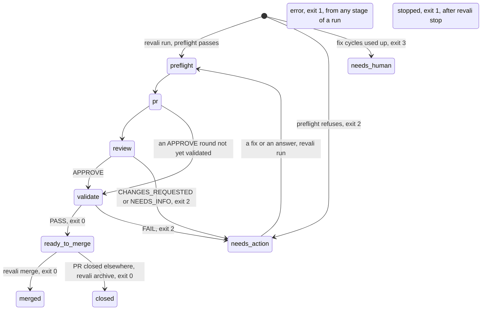

# Workflow

How a change moves from a request to a merged PR, what the three sessions
see, and how several agent sessions share one repository. The command
reference is in the README; configuration keys are in [docs/configuration.md](configuration.md).
To install revali first, see Installing revali below.

## Why separate sessions

Each role runs in its own session with its own inputs, so nobody grades
their own work: the Developer never reviews the change it wrote; the
Reviewer gets the acceptance criteria, the diff and the documents the diff
concerns, not the Developer's reasoning, and derives its tests from the
criteria; the Validator is a test
run, not an opinion; the diagnosis session gets change.md, tests.md, the
Reviewer's test files, the failing step's command and output, the rerun on the base
tip and the other platforms' outcomes, and reads the repository read-only, but gets
neither the Developer's nor the Reviewer's reasoning. The
models can differ by tier (`auto` puts the Reviewer one tier above the
Developer); the engine seam is where a second vendor would plug in
(only `claude` exists today). Fresh context removes the author's bias toward
its own change; it does not remove blind spots the models share, which is
why `revali stats` tracks the first-try pass rate (branches that reached
`ready_to_merge` with no fix cycle). A branch counts once per PR, by its last recorded
stop: `ready_to_merge` or `merged`.

## Workflow

The acceptance criteria come before the code. In a project that has
`revali.toml`, the author session (Claude Code following
[skill/SKILL.md](../skill/SKILL.md), or you) starts a change by writing
`.revali/<branch>/change.md` from [templates/change.md](../templates/change.md) with the
`Request`, `Goal`, numbered acceptance criteria, `Out of scope`, and
`Dependencies` sections, keeps `status: draft` in the front matter, and
shows the criteria to the user. Approval means deleting the `status: draft`
line; preflight refuses a draft (`change.md: status is 'draft'; review it and
remove the status line`), so nothing runs on unapproved criteria.
Then the author implements, writes its own tests, runs the existing suite,
fills in `What`, commits, and the user types `/revali`. The reviewer's
acceptance tests come on top of the author's tests, not instead of them.

Each acceptance criterion is one bullet, `- AC-n: text`, with at least one
such line and at least eight characters of text in each. A note may stand in
parentheses before the colon (`- AC-2 (PR #30 F1): text`), and the text goes
on over the lines after it, indented continuation lines or unindented ones, up
to a blank line, a `## ` section heading or a list item indented no deeper than the AC. Only
the Acceptance criteria section is checked: any other line in it that starts like an AC
(`- **AC-3**: ...`, `- AC-3 text`, `1. AC-4: ...`) stops preflight with exit 1,
listed with the line's number among the other change.md problems; a paragraph
that merely begins with an AC id, without a bullet or a colon, is prose.
Preflight's `ok:` line lists the ids it parsed, so a criterion that was not
read is visible before anything is pushed.

To make an authoring session do this without being asked each time, paste
[templates/CLAUDE-snippet.md](../templates/CLAUDE-snippet.md) into the project's `CLAUDE.md`;
`revali init` does that (Project setup below).

## Several agents on one repository

One working tree has one checked-out branch, so give every agent session
its own worktree: `git worktree add ../<name> -b <branch>` from the primary
tree, then work, run and merge there. Each worktree has its own `.revali/`
state and locks, so runs in different worktrees are independent. A second
`run` in the same checkout, whatever branch it is on, is refused by
`tree.lock` with the running branch and pid; `wait --branch <b>` waits for
that run and `stop` stops it, from any branch or a detached HEAD. Sandbox
clones are keyed `<repo>/<branch>-<key>/<label>` on the WSL distro or the ssh
host, where `<key>` comes from the checkout's path and the exact branch
name (earlier revali versions used `<repo>/<branch>/<label>`), so validations
of different branches, and of different repositories whose directories
share a name, never share a directory.
`merge` from a linked worktree merges the PR, deletes the remote branch,
detaches the worktree at the merged base and drops the local branch; the
worktree itself stays until you run `git worktree remove <path>` from the
primary tree, and `git pull` in the tree that holds the base (the merge
output's `worktree:` line names it) brings in the merge. `merge` in the primary
tree while a linked worktree holds the base branch is refused. Two clones
with the same branch checked out are not a supported layout: they would
share the PR.
Worktree mode in `merge` (no `--delete-branch`, detach, drop the local branch
by hand) applies only when the base branch is checked out in another
worktree; a linked worktree whose base is checked out nowhere else merges
like the primary tree, with `--delete-branch`, and gh checks out the base
there. After a merge outside worktree mode, revali checks out the base if
gh did not and runs `git pull --prune`, once more after a short pause when
it fails. A checkout or pull that still fails is a `note:` line with git's
error (both errors when the two attempts differ, since a first attempt that
stopped in a conflict makes the second fail for that reason) and what to
run. Any other git failure while updating the tree is a note saying
updating the tree stopped. When git cannot be run while deleting the
local branch, the `local:` line says it could not tell whether the branch
was removed; a `git branch -D` that runs and fails leaves the branch, and
the line says it was kept, with git's error. The PR is merged, so the
exit code stays 0.

## Running

`run`, `wait`, `status`, `reset`, `merge`, `stop`, `archive` and `clean`
print one identity line first,
`repo: <working tree root>  branch: <branch>` (`preflight` prints it only
before a state file it cannot use; its own first line names the repo and
branch otherwise), so several sessions running
revali in different checkouts can tell their output apart; the messages that
name a live run carry its pid: `started revali run`, `run`'s refusal while
another run holds the branch or the tree, `wait`'s still-running line,
`status`'s `running: yes` and the pid `stop` stopped. Which revali ran is in the
run's own records: preflight's first line, `repo <root>, branch <branch>,
revali <build>` (in `logs/revali.log`, and in `logs/run.log` for a detached
run), the `started revali run` line, and the history row's `revali_build`.
The build is the version plus `git describe --tags --always --dirty` of the
checkout revali was loaded from, e.g. `0.3.0 (v0.3.0-27-g4fbdb4e)`; a
checkout at a release tag shows the tag alone, e.g. `0.4.0 (v0.4.0)`. It is the
version alone when that directory is not the root of a git checkout or git
cannot describe it (git missing, timed out or failed). On Windows the detached
run starts every subprocess (git, gh, claude, wsl, the `lint` line and the
`local` runner's steps) with `CREATE_NO_WINDOW`, so no console windows
appear while it works. `run` checks the working tree before it detaches:
when preflight would refuse it (an uncommitted change outside `.revali/`,
other than a NEEDS_INFO round's pending files) it prints the same `working
tree is not clean` message with the paths and returns 1 without starting
anything; the refusal is recorded as stage `error` with exit 1, so `wait`
and `status` report it rather than the previous run's result. After an
interrupted review round it leaves the check to the run itself, which
first cleans up what that round left. `status` then prints the stage, the last message,
the round / fix-cycle / cost counters, the PR, and, once the branch has a
review round, the cost of each round (`cost per round: r1 $4.10, r2 $2.30`, then
`; diagnosis $x` for the validation diagnoses and `; other $y` for reviewer sessions that
ended without a round, when there are any; READY TO MERGE and the `merge` summary print
the same line) and `tests: commit` or `tests: archive`: the mode its rounds run
in, fixed for the branch (`[review] tests` in
[docs/configuration.md](configuration.md)).

The stage in `state.json` moves like this; `wait` returns the exit code of the
stage a run ended in, `status` prints the stage, and [docs/files.md](files.md) says
what each one means:



A pipeline error at any stage of a run (a red baseline, a change.md problem, the
tree moved, an unexpected exception) ends in `error`, and `revali stop` ends a run
in `stopped`. `preflight` is recorded once preflight has passed, so a run it
refuses goes from the previous run's stage straight to `needs_action`,
`needs_human` or `error`. It refuses with exit 2 when the branch needs a
rebase, `[project] format` does not name `{files}`, the lint line fails, the
diff is too large, git tracks files in the state directory, nothing changed
since a review or validation that asked for a fix, or `[review] tests`
differs from the mode the branch's rounds ran in. `run --dry-run` ends at
`preflight` with exit 0. A run that dies
without recording a result keeps its last stage, and `wait` and `status` report
it as died (below). `revali archive` records `merged` or `closed` from any stage
once the branch has a PR. `revali merge` also merges from the stage a later run
stopped in before its `pr` stage (`error`, `stopped`, `needs_action`, or
`preflight` after `run --dry-run`) while HEAD is still the commit the last
validation passed on ([docs/files.md](files.md)).

A run goes preflight, PR, review, validate. Preflight runs `git fetch
origin <base>` and compares the branch against `origin/<base>`; a fetch
that fails is tried once more after a short pause, since worktrees of one
repository share `refs/remotes/` and of two fetches of the same ref at the
same moment one fails after the other has moved the ref (`revali merge`
from a linked worktree retries its fetch of the base the same way, and from
the primary tree its `git pull --prune`). When both attempts fail,
preflight prints a note with git's error and compares against the local
`<base>`, which may be behind the remote. Before that, right after the
clean-tree check, preflight stops with exit 2 while git tracks any file under
the state directory (`.revali/`, or `[paths] state_dir`) in the index or in
HEAD, whether the branch committed it, the base already had it, or it is only
staged: it lists the files (twenty, then a count) and says to run `git rm -r
--cached .revali` and commit (a removal staged but not committed is refused
too, since the push would still carry the files). Nothing is fetched, pushed
or sent to GitHub before that check. When the files came from the base, that
commit removes them from the base at merge, and the next `git pull` in other
checkouts deletes the tracked files of those old state directories (untracked
files beside them stay). On the first pass of a branch
(no review round yet, not a dry run, not `kind: docs`) preflight ends with
the baseline: the existing suite on the commit preflight checked, in the
sandbox. With `[validate] parallel_baseline` (the default) the baseline only
starts there and runs on while the PR stage and the round 1 reviewer run;
revali acts on the reviewer's answer (smoke run, test commit, push, PR
comment) only once the baseline has passed, and `logs/revali.log` says when
it is waiting for it. A baseline that fails stops the reviewer session, or
discards its answer when it came first, and the run ends with exit 1 and
"branch is broken before review" as it always did, with a line saying what
became of the reviewer. A run that ends for any other reason while the
baseline runs waits for it before exiting, so no sandbox session is left
behind. `parallel_baseline = false` runs the baseline inside preflight,
before anything is pushed or paid for.

A working tree runs one pipeline at a time: `run` takes `.revali/tree.lock`
next to the branch lock, and a second `run` in the same checkout, on any
branch, is refused with the running branch and pid. `wait --branch <b>`
waits for another branch's run from wherever you are; `stop` stops the run
of this working tree whatever branch is checked out. Two worktrees of one
repository (`git worktree add`) have separate state directories and locks.
While it works, a run checks before spawning the reviewer, before committing
its tests, before every push and before validation that the checked-out
branch and HEAD are still its own; when another session moved them it stops
with exit 1 (stage `error`) and commits and pushes nothing from that point.

After exit code 2 the author fixes or answers in
`.revali/<branch>/response-<n>.md` (`- F1: fixed` / `- F1: wontfix: <reason>`),
commits, and runs again; a cycle after a CHANGES_REQUESTED round or a failed
validation counts against `review.max_fixes`, and answering a NEEDS_INFO round
or fixing a preflight refusal does not.
The cycle is owed from the moment a CHANGES_REQUESTED round is saved (from
the exit 2 of a failed validation) until a run passes preflight on a new
commit and counts it. A run that stops before the review (preflight, the
refusal before detaching, `revali stop`, an unexpected error) or after a
CHANGES_REQUESTED verdict is saved (the push of the test commit fails, the
tree moved, the PR comment cannot be posted) neither loses nor repeats a fix
cycle: the next run on the HEAD the reviewer left (its test commit, when it
made one) is still refused with "nothing changed", naming the round and its
`review-<n>.md`, and the next run on a new commit counts the cycle once. A
test commit that was not pushed goes out with the next run that gets past
preflight.
The exit 2 message lists what blocks and also the findings that did not
block, with the path of `review-<n>.md` (a detached run writes it to the end
of `logs/run.log`); the `revali wait` line carries the blocking /
non-blocking counts and that path, and the findings are read there: a `low` or `medium convention` finding left
unanswered comes back as unresolved in the next round. READY TO MERGE lists the
approving round's non-blocking findings too.

From round 2 on, a round whose findings are all `low`, with none of the previous round's
findings left `unresolved`, and every one of them at a line inside, or within 3 lines of,
what the author changed since the previous round (from the reviewer's test commit of that
round, when it made one, to the head this round reviewed) gets a `hint:` line on READY TO
MERGE and on the exit 2 message of a CHANGES_REQUESTED verdict that only the reviewer's own
verdict asks for: those findings sit in the last fix. On READY TO MERGE the hint says that
answering them in `response-<n>.md` (`wontfix` or a follow-up) costs less than another
round; after CHANGES_REQUESTED, where the next round runs anyway, it suggests answering
them there rather than changing those lines again. The stage message, which `wait` and
`status` print, ends with a short form of it. The hint changes
nothing else: the exit code, the stage, `max_fixes` and `merge` are as without it. A
NEEDS_INFO round, a round that revali blocks for another reason (an unjustified test or
dependency change, an AC without a test, a question asked a second time), a failed
validation, a finding at line 0 or in a file the fix did not touch, and a previous tip that
is no longer an ancestor of the head give no hint; the last case, which revali.log names,
comes from a rebase in archive mode or after a round that committed no tests (in commit
mode a rebase that drops the reviewer's test commit starts the review over at round 1).

A Reviewer session that stops because its model's usage limit is reached ends
the run with exit 1 (stage `error`) and one line: `reviewer model <m> hit its
usage limit: <the engine's text, with the reset time>; nothing is lost: run
`revali run` again after the reset, or `revali run --reviewer-model <model>`
for this run only`. What the session spent is counted, and the stop itself
uses no fix cycle. A Reviewer model that is overloaded (status 529) ends the run
the same way: `reviewer model <m> is overloaded: ...; nothing is lost: run
`revali run` again later, or ...`; with the default `fallback_model = "auto"` the
Reviewer has no fallback, so it never runs on another model unasked. revali does not switch to a lower tier by itself, since that would put
the Reviewer at or below the author's tier; `--reviewer-model` is that choice,
made by the user for one run ([docs/configuration.md](configuration.md)). A
diagnosis session that hits the limit, or whose model is overloaded, leaves the
validation result as it is, and its "diagnosis unavailable" line names the limit
or the overload and `[validate] model`.

A run that stops without a result (the process was killed, the machine went
down, an unexpected error) is reported as such: an unexpected error is
recorded as stage `error` with exit 1 and the traceback in `logs/run.log`;
when nothing could record anything, `wait` prints `died at stage '<stage>'
without a result` and returns 1, and `status` prints `running: no; the last
run stopped at stage '<stage>' without a result (see <path to logs/run.log>)`
after its `stage:` line.
`revali stop` acknowledges such a run: with no live process
and no result recorded it sets stage `stopped` (exit 1) and removes the
stale lock, after which `wait` and `status` report a stopped run; a state
that already holds a result is left alone (`no run in progress`). Every
`stop` that records a run as stopped, killed or found dead, also appends a
history row (stage `stopped`, exit 1) so `stats` counts the episode; when
the state file cannot be written (a reader holding it on Windows past the
retry window) `stop` says so on one `ERROR:` line and returns 1, the process
is still killed, and the run keeps reading as dead until `stop` is run
again. The next
`run` continues where the last one stopped when it
can: if the last reviewer round was APPROVE, no validation is recorded for it,
and HEAD is still the commit that round left (the reviewer's test commit),
the run skips the reviewer and goes to validation, so the review is not paid
twice. The rule keys on that commit: amend or rebase it and the next run is a
normal new round.

revali's own CI ([.github/workflows/test.yml](../.github/workflows/test.yml)) runs lint and the
suite on Linux, Windows and macOS on every push, and `revali merge` waits for it as it waits
for any project's checks. Every leg runs as jobs in parallel, each one shard of the suite
(`RUN_PARALLEL_SHARD=K/N`, the same as `tests/run_parallel.py --shard K/N`), which together
run every test once on each: two for each Ubuntu Python version (lint on the first 3.x job
only), six on Windows and three on macOS, and `revali merge` waits for all of them. The
macOS jobs install GNU coreutils first, since the sandbox runs each step under `timeout`.
The shards are balanced by the seconds per test class recorded in
[tests/durations.json](../tests/durations.json) (the runner's docstring says how to refresh
it). revali's own
`revali.toml` raises `checks_timeout_min` above the job's `timeout-minutes`; its comment has
the measured times. A leg's time depends on the runner it lands on, so every leg
prints the CPU model and the logical processor count before the suite
([.github/runner_facts.py](../.github/runner_facts.py)).

How often the reviewer finds a bug it is known to have found before is measured by
[tools/review_bench.py](../tools/review_bench.py), which replays archived review rounds as a first round;
[bench/README.md](../bench/README.md) says how to run it and build a case.

A PR merged without `revali merge` (the web UI, a plain `gh pr merge`, a
`revali merge` interrupted after its merge) or closed without merging is
recorded with `revali archive`, or `revali archive --branch <branch>` from
another branch or a detached HEAD: it asks gh how the PR ended and never
merges it. Merged, the stage becomes `merged` and the local branch goes unless it
is checked out or holds commits the PR did not show;
closed, the stage becomes `closed` and the branch stays. Either way the
history row says so and the review files move to the archive as at
`revali merge`, so `revali stats` stops counting the branch as ready to
merge. `revali clean <branch>` deletes the review files instead
([docs/side-effects.md](side-effects.md)).

## Installing revali

Clone the repository and check out the newest release tag (the repository's GitHub
Releases page lists them, or `git tag --sort=-v:refname` after the clone), not main:
main changes with every merged PR, and `PROMPT_VERSION` with some of them, so a
checkout that follows it changes the review of every project that runs from it. The
checkout is then a detached HEAD at the tag, which is expected.

```
git clone https://github.com/ianmhuang/revali <revali dir>
git -C <revali dir> checkout v<version>
```

Link its `skill/` directory as `~/.claude/skills/revali`, so Claude Code finds the
`/revali` skill: a junction on Windows, a symbolic link elsewhere. The first line of
each pair below creates `~/.claude/skills` if it is not there yet; `~/.claude/skills/revali`
itself must not exist yet (`ln -s` would put the link inside an existing directory).
Write `<revali dir>` as an absolute path here: `ln -s` keeps a relative target as
written and resolves it from the link's own directory, so `revali/skill` would point
nowhere.

In PowerShell:

```
New-Item -ItemType Directory -Force "$HOME\.claude\skills"
New-Item -ItemType Junction -Path "$HOME\.claude\skills\revali" -Target "<revali dir>\skill"
```

In cmd:

```
if not exist "%USERPROFILE%\.claude\skills" mkdir "%USERPROFILE%\.claude\skills"
mklink /J "%USERPROFILE%\.claude\skills\revali" "<revali dir>\skill"
```

On Linux or macOS:

```
mkdir -p ~/.claude/skills
ln -s "<revali dir>/skill" ~/.claude/skills/revali
```

The project's `CLAUDE.md` names that checkout as `<revali dir>` (see Project setup
below): write the path in, or name it once in your own global Claude instructions.

To update, fetch the tags and check out the newer one in the same checkout; the link
and every project follow it:

```
git -C <revali dir> fetch --tags
git -C <revali dir> checkout v<newer version>
```

A checkout used to develop revali is not the one other projects run from: give
development its own clone or worktree. A run in progress still reads files from its
checkout after it starts (prompts, schemas, templates), so move a checkout only while
no run from it is in progress.

## Project setup

Run `python <revali dir>/revali.py init` once in the project's repository. It writes each
of the files below that the project does not have yet, never overwrites one, commits
nothing, and lists what it wrote and kept; then edit the commands in `revali.toml` and
commit.

What init does, which is also how to do it by hand:
copy [templates/revali.toml](../templates/revali.toml) to the repo root and edit the commands; copy
[templates/CONVENTIONS.md](../templates/CONVENTIONS.md) if the project has none; copy
[templates/release.yml](../templates/release.yml) to `.github/release.yml`; add `.revali/` to
`.gitignore`, or to `.git/info/exclude` if the line must stay out of the
tracked `.gitignore` (see [docs/side-effects.md](side-effects.md)); paste
[templates/CLAUDE-snippet.md](../templates/CLAUDE-snippet.md) into the project's
`CLAUDE.md` (init appends it unless `CLAUDE.md` already has its `## Changes go through
revali` heading, and leaves `<revali dir>` in it for you to replace or to name in your
global Claude instructions). Before each run the author writes
`.revali/<branch>/change.md` from [templates/change.md](../templates/change.md) (branch `feature/x`
maps to directory `feature__x`); see Workflow above.

User-level options live in `~/.revali/config.toml` (see
`templates/user-config.toml`); `REVALI_HOME` overrides the directory.
